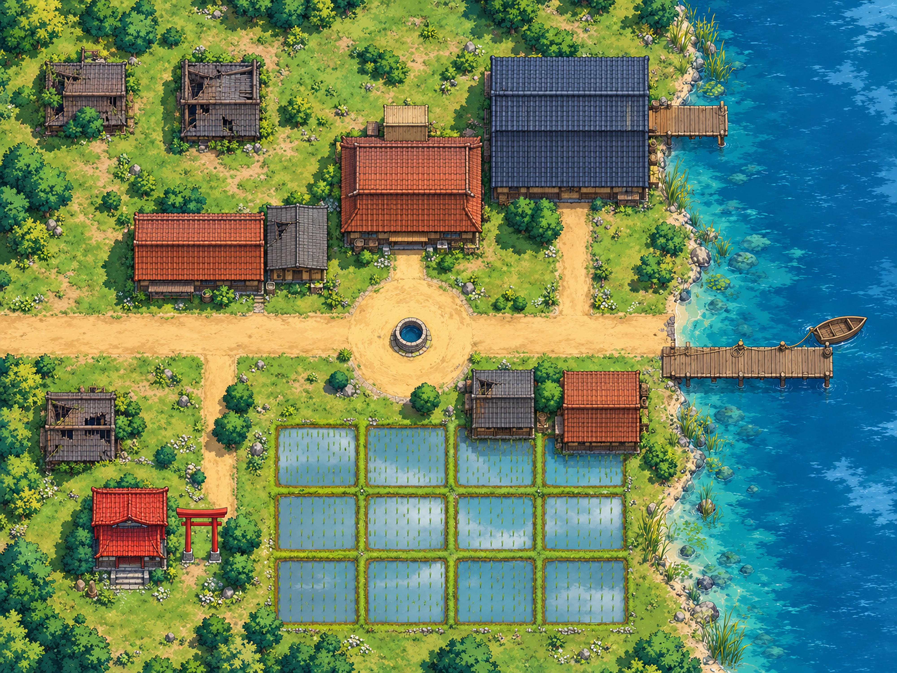

# One-shots N5eB

Scénarios prêts à jouer pour **Foundry VTT** et le système **N5eB (Naruto 5e)**, en français.

## Les Feux Follets de Kawabe — v1.0.1

Une mission de rang C pour **5 genin de niveau 1**, prévue pour **3 à 4 heures**. Un village de pêcheurs demande l'aide de Konoha : chaque nuit, un mystérieux fantôme apparaît sur le lac Kagami.

Le module contient 5 prétirés, 12 PNJ et adversaires, 4 scènes, 6 journaux, 43 pages, 8 objets, une table de rumeurs et **46 illustrations finales** inspirées de Naruto. Le scénario s'importe avec l'importeur d'aventure standard de Foundry, depuis le compendium du module.



## Installation dans Foundry

Prérequis déclarés par le module : **Foundry VTT v13/v14** et **N5eB 3.0.0 ou supérieur**.

Dans **Configuration → Modules → Installer un module**, collez cette URL dans le champ **URL du manifeste** :

```text
https://github.com/PrevotYann/one-shots-n5eb/releases/latest/download/module.json
```

Ouvrez ensuite votre monde N5eB, activez le module et importez le scénario. Les instructions détaillées figurent dans le [README du module](n5eb-feux-follets/README.md).

La [dernière release](https://github.com/PrevotYann/one-shots-n5eb/releases/latest) fournit également le ZIP du module, le manifeste et les empreintes SHA-256. Pour une installation manuelle, extrayez le contenu du ZIP dans `Data/modules/n5eb-feux-follets/`.

## Sources et illustrations

- `n5eb-feux-follets/` : fichiers du module à installer.
- `tools/` : scripts Python de construction, de validation et de création du ZIP.
- `art-source/preview.html` : galerie locale des 46 visuels.
- `art-source/masters/` et `art-source/prompts.json` : 22 masters PNG et leurs prompts imagegen.
- [Historique des versions](CHANGELOG.md).

## Construire une release

Depuis la racine du dépôt, avec Python 3.10 ou supérieur, Node.js et les dépendances de `requirements.txt` et `package.json` :

```shell
python -m pip install -r requirements.txt
npm install
python tools/build.py
python tools/validate_art.py
node tools/build_packs.mjs
node --check n5eb-feux-follets/scripts/main.mjs
python tools/package_release.py
```

Les fichiers de release sont écrits dans `output/v1.0.1/`. Le build conserve les illustrations finales. `python tools/final_art.py` permet de les réexporter à partir des masters, sans appeler de modèle d'image.

Les validations portent sur les données, les liens et les fichiers graphiques. L'import dans un monde Foundry réel n'a pas encore été testé.
